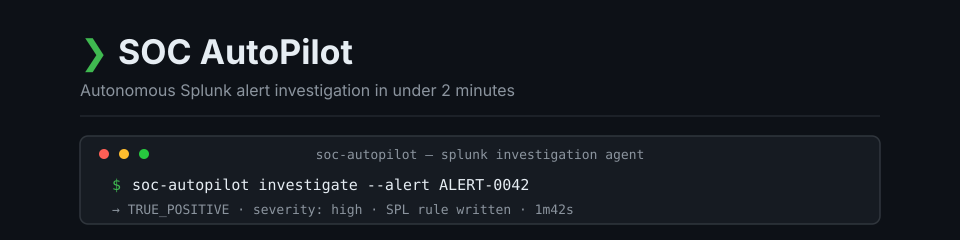
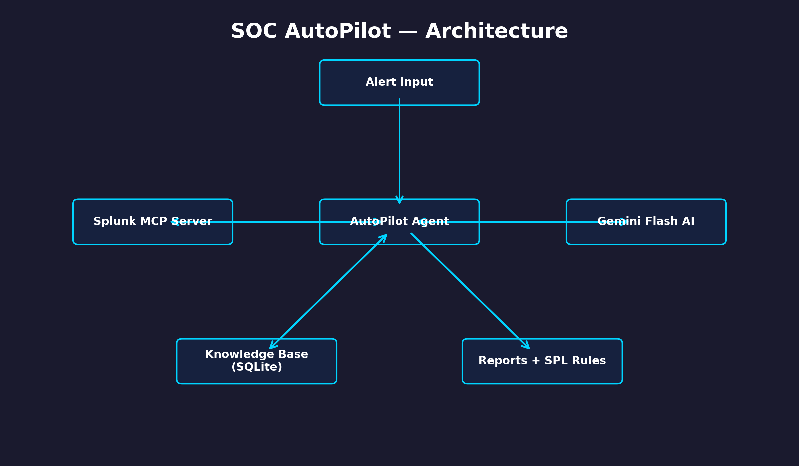

# SOC AutoPilot

[](https://github.com/Santhosh595/SOC-AutoPilot/actions/workflows/ci.yml)
[](https://www.python.org/downloads/)
[](LICENSE)

<p align="center">
  
</p>

**SOC AutoPilot — Autonomous AI agent that investigates Splunk security alerts in under 2 minutes**

## The Problem

SOC teams are overwhelmed by alert fatigue: analysts receive an average of 2,992 alerts per day, and 42% go uninvestigated. Breaches often begin in that gap, when real threats are buried under repetitive noise, false positives, and manual triage backlogs. SOC AutoPilot helps close the gap by automating the first-pass investigation workflow.

## How It Works

1. **Extract IOCs** from the alert description, including IP addresses, usernames, and domains.
2. **Check the knowledge base** for similar past investigations and known false-positive patterns.
3. **Pull live logs from Splunk** using Splunk MCP-compatible REST queries.
4. **Classify the threat with AI** using Gemini Flash and available log context.
5. **Generate an investigation report** with findings, verdict, severity, recommended actions, and SPL.
6. **Save the investigation** to the local knowledge base for future learning and analyst feedback.

## Demo

[Demo GIF coming soon]

YouTube video: [Coming soon](https://youtube.com/)

## Features

- Autonomous 6-step investigation pipeline
- Splunk MCP Server integration for live log queries
- Gemini Flash AI for threat classification
- Self-learning knowledge base (remembers past investigations)
- False positive detection from historical patterns
- Auto-generates SPL detection rules
- Analyst feedback loop
- Supports multiple AI backends (Gemini supported; Groq, Ollama planned)

## Architecture



## Splunk Integration

SOC AutoPilot connects to Splunk via the Splunk REST API (`/services/search/jobs`) using basic auth (username/password). This is compatible with the Splunk MCP Server app on Splunkbase, which exposes the same REST endpoints. The `mcp` Python package is included in `requirements.txt` for future native MCP transport support.

## Setup

### Prerequisites

- Python 3.10+
- Git

### 1. Clone Repo

```bash
git clone https://github.com/Santhosh595/SOC-AutoPilot.git
cd SOC-AutoPilot
```

### 2. Run Installer

```bat
install.bat
```

### 3. Configure Environment

Copy `.env.example` to `.env` and fill in your credentials:

```bash
copy .env.example .env   # Windows
# or
cp .env.example .env     # macOS / Linux
```

```env
GEMINI_API_KEY=your_key_here
SPLUNK_TOKEN=your_token_here
```

Get a free Gemini API key from [Google AI Studio](https://aistudio.google.com/).

> **No keys? No Splunk?** Set `demo_mode: true` in `config.yaml` — the
> LLM step is skipped gracefully and the pipeline runs on extracted IOCs
> with safe defaults. Splunk connectivity problems never crash the agent.

### 4. (Optional) Connect Splunk

Set `demo_mode: false` in `config.yaml`, install the Splunk MCP Server app from
[Splunkbase](https://splunkbase.splunk.com/), then add your Splunk token to `.env`.

## Usage

Test Splunk connectivity:

```bash
python main.py test
```

Investigate an alert:

```bash
python main.py investigate "Brute force attempt from 185.220.101.45 against admin account"
```

View investigation history:

```bash
python main.py history
```

Add analyst feedback:

```bash
python main.py feedback --id 1 --verdict FALSE_POSITIVE --note "Known scanner"
```

## AI Backends

| Backend | Status | Setup |
| --- | --- | --- |
| Gemini | ✅ Default | Add `GEMINI_API_KEY` to `.env`, set `ai.provider: gemini` in `config.yaml`. |
| Groq | 🔜 Planned | Not yet implemented — `llm_adapter.py` currently accepts Gemini only. |
| Ollama | 🔜 Planned | Not yet implemented — `llm_adapter.py` currently accepts Gemini only. |

## Notifications

SOC AutoPilot can automatically alert you over **Slack** and/or **Email**
when a MALICIOUS threat with CRITICAL or HIGH severity is detected.

### Slack (free)

1. In your Slack workspace go to **Settings → Manage apps → Incoming Webhooks**.
2. Create a new webhook, pick a channel, and copy the URL.
3. Paste the URL into `config.yaml`:
   ```yaml
   notifications:
     slack_webhook: "https://hooks.slack.com/services/T.../B.../xxxx"
   ```

### Email (Gmail)

1. Enable **2-Step Verification** on your Google account.
2. Go to [myaccount.google.com/apppasswords](https://myaccount.google.com/apppasswords)
   and generate an App Password for "Mail".
3. Add to `.env`:
   ```env
   SMTP_PASSWORD=your_app_password_here
   ```
4. Fill in `config.yaml`:
   ```yaml
   notifications:
     email_to: "soc-team@company.com"
     email_from: "your.gmail@gmail.com"
     smtp_host: smtp.gmail.com
     smtp_port: 587
   ```

> **Note:** Both channels are optional. If neither is configured the
> investigation still completes — notifications are simply skipped.

## Tests

The test suite covers the agent's **pure logic** — IOC extraction, threat-level
mapping, private-IP detection, and the knowledge base's similarity search. It
needs no Splunk, no LLM key and no `ABUSEIPDB_API_KEY`, so it runs anywhere:

```bash
pip install -r requirements.txt
pip install pytest
python -m pytest tests/ -q
```

It runs in CI on Python 3.10, 3.11 and 3.12.

## Built For

Splunk Agentic Ops Hackathon 2026 — Security Track

## License

MIT
